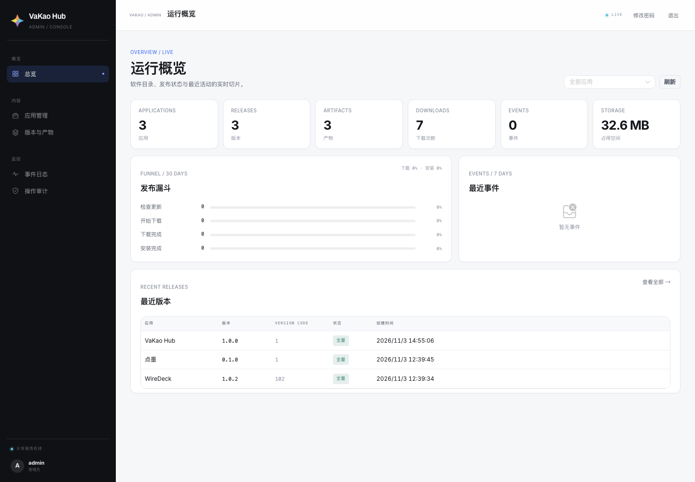

# VaKao Hub Admin（管理后台）



Vue 3 + Vite + Naive UI 的管理端，部署在 `/admin/`。视觉令牌、字体与布局规范见 [`docs/design-system.md`](../../docs/design-system.md)。

- 登录：`docs/screenshot-login.png`
- 总览：`docs/screenshot-dashboard.png`
- 应用管理：`docs/screenshot-apps.png`
- 版本与产物：`docs/screenshot-releases.png`

构建（同域 `/admin/`）：

```bash
ADMIN_BASE=/admin/ pnpm build
```
