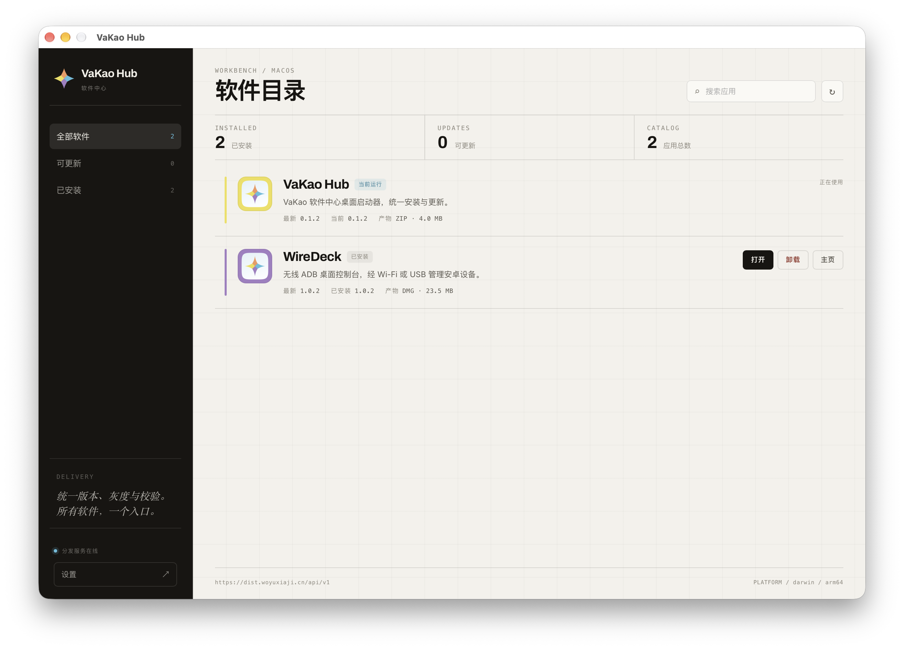

# VaKao Hub Launcher（桌面启动器）

VaKao 软件中心的桌面客户端：读取分发服务的应用目录，下载产物、校验 SHA-256、安装并启动。



## 技术栈

- Wails v2.17 + Go 1.27
- Vue 3 + Vite 7 + TypeScript
- 无第三方 UI 库，界面样式集中在 `frontend/src/style.css`

## 开发与构建

```bash
# 开发（热更新，Wails 内置 Vite）
wails dev

# 生产构建
wails build

# 产物
build/bin/VaKaoHub.app
```

默认连接生产服务 `https://dist.woyuxiaji.cn/api/v1`；本地开发在应用「设置」中改为 `http://127.0.0.1:3000/api/v1`。

## 功能

- 应用目录：按当前操作系统与 CPU 架构过滤，展示最新版本、已安装版本与可更新状态；
- 安装/更新：下载（带进度事件）→ SHA-256 校验 → 平台安装；
- 打开：调用系统默认方式启动已安装应用；
- 自检测：启动器识别当前运行的 `.app`，不会把自己当成未安装而再次安装；
- 手动安装识别：扫描 `~/Applications` 与 `/Applications`，手动拖入的应用也会显示为已安装；
- 重复安装提示：同一应用存在多份时列出路径，更新时替换已有路径而不是再复制一份；
- 自动刷新：启动即加载，之后每 30 分钟静默刷新；顶部显示可更新数量；
- 断点续传：半包保存在 `~/Library/Caches/vakaohub/downloads/<artifactID>.part`，下次继续；
- 强制更新：未更新到最新版时「打开」被禁用并提示；
- 安装校验：SHA-256 + `codesign --verify --deep --strict`（未签名或签名损坏会被拒绝）；
- 卸载：删除应用目录并移除已安装记录（只允许约定安装目录）；
- 已安装记录：`~/Library/Application Support/vakaohub/installed.json`（Windows 为 `%AppData%\vakaohub`）；
- 设置：分发服务地址持久化到同目录 `settings.json`。

## 平台安装策略

| 平台 | 支持格式 | 安装位置 |
| --- | --- | --- |
| macOS | dmg、zip | `~/Applications/<App>.app`（DMG 挂载后 `ditto` 复制） |
| Windows | zip、msi、exe | zip 解压到 `%AppData%\VaKaoHub\apps\<appKey>`；msi 静默安装；exe 调起安装器 |
| Linux | zip、appimage | `~/.local/share/vakaohub/apps/<appKey>` 或 `~/Applications` |

macOS 使用内置 `hdiutil`/`ditto`，不修改系统安全设置；未公证的应用首次启动仍可能被 Gatekeeper 拦截，启动失败时应用会提示「右键 → 打开」或到系统设置放行。要彻底消除提示，需要 Apple Developer Program（Developer ID 签名 + 公证）。

## Windows 构建

Windows 需要 Windows 机器或 CI。仓库提供 [`.github/workflows/launcher-windows.yml`](../../.github/workflows/launcher-windows.yml)，在 GitHub Actions 的 `windows-latest` 上安装 Wails、编译并上传 `VaKaoHub.exe`。

## 托盘

暂未实现系统托盘：Wails v2 与常见 Go 托盘库都要求占用主线程，两者同时启动会冲突；后续换 Wails v3 或原生 `NSStatusItem` 再补。

## 冒烟测试

需要本地服务已启动，并已在后台创建 `wiredeck` 应用与 macOS 产物：

```bash
VAKAO_HUB_SMOKE=1 go test -run TestSMOKECatalogAndInstall -v .
```

测试会真实下载 DMG、校验 SHA-256、安装到 `~/Applications`；`TestSMOKEUninstall` 会卸载并校验记录被清除。半包续传可通过预先放置 `~/Library/Caches/vakaohub/downloads/<artifactID>.part` 验证。

## 目录

```
launcher/
├─ app.go                 # Wails 绑定：目录/安装/启动/设置/进度事件
├─ settings.go            # 服务地址持久化
├─ internal/api/          # 分发服务 HTTP 客户端与类型
├─ internal/store/        # 已安装应用记录
├─ internal/install/      # 分平台安装与启动
└─ frontend/              # Vue 3 界面
```
