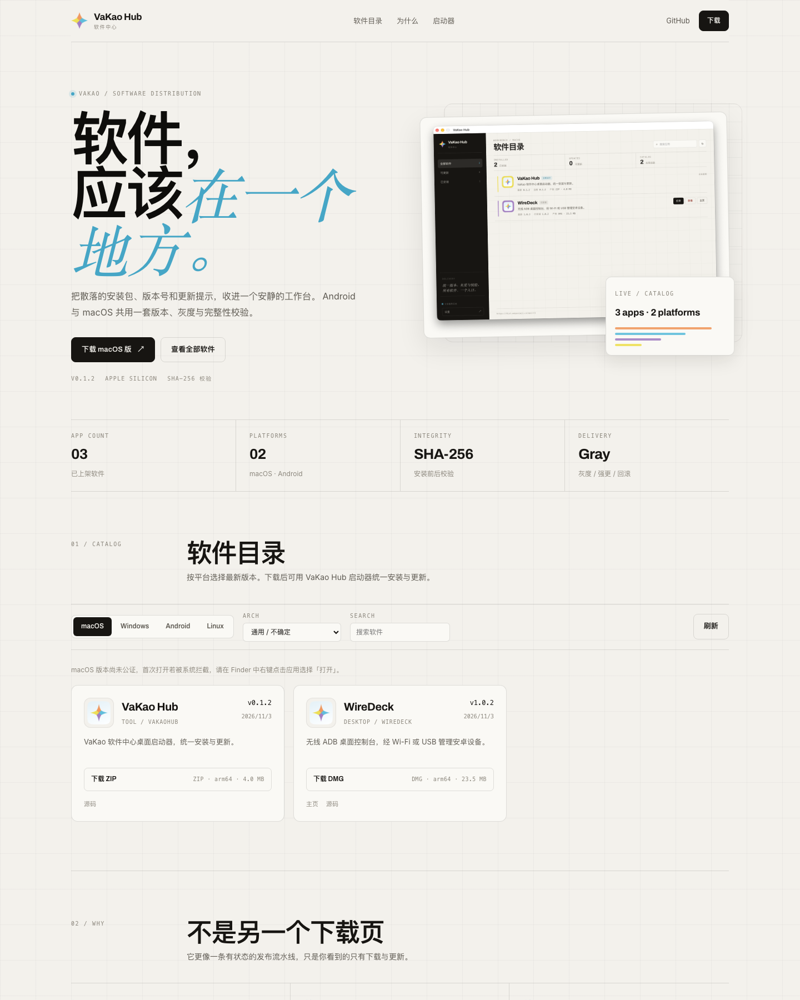

# VaKao Hub Website（下载页）



设计语言与令牌见 [`docs/design-system.md`](../../docs/design-system.md)。

独立静态下载页，读取分发服务的 `/catalog` 接口，按平台展示最新版本与产物。

## 本地预览

先启动服务端（`pnpm dev` 或 `pnpm dev:server`），然后：

```bash
python3 -m http.server 5200 --directory packages/website
# 打开 http://localhost:5200
```

页面默认在 `localhost` 下访问 `http://127.0.0.1:3000/api/v1`；也可以用查询参数指定：

```
http://localhost:5200/?api=https://dist.example.com/api/v1
```

服务端 CORS 默认放行 `http://localhost:5200` 与 `http://127.0.0.1:5200`。

## 生产部署

推荐把静态文件放在站点根目录，Nginx 把 `/api/` 反代到分发服务：

```nginx
root /www/wwwroot/vakaohub-website;
location / {
    try_files $uri $uri/ /index.html;
}
location /api/ {
    proxy_pass http://127.0.0.1:3000;
    proxy_set_header Host $host;
    proxy_set_header X-Forwarded-Proto $scheme;
    proxy_set_header X-Forwarded-For $remote_addr;
}
```

页面在同域下会自动使用相对路径 `/api/v1`，无需改代码。

## 说明

- 平台默认按 UA 猜测，用户可手动切换；架构默认「通用 / 不确定」，切换后重新查询。
- macOS 未签名/未公证时，首次打开需要右键 → 打开，页面会提示。
- 下载链接直接使用服务端 `downloadUrl`（`PUBLIC_BASE_URL` 或请求头推导），换域名不需要改页面。
